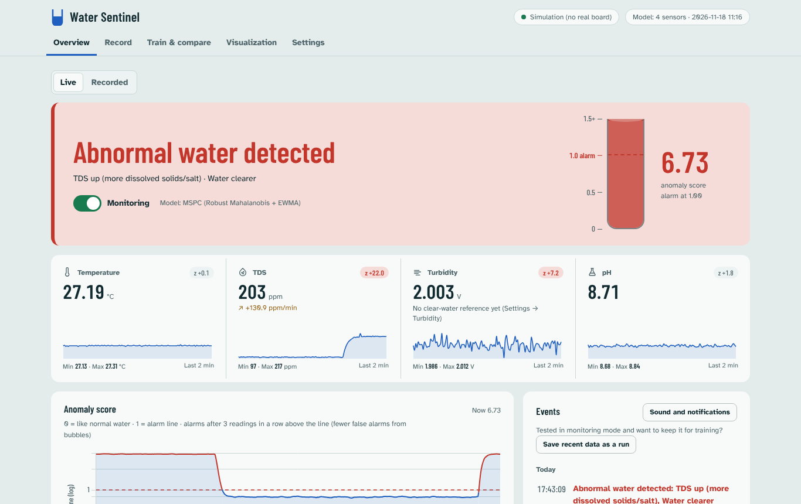
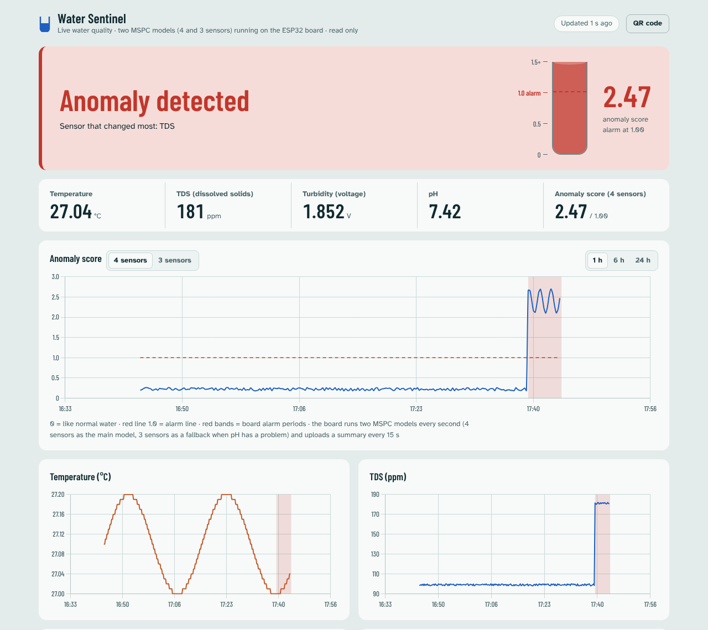

# Water Sentinel

Real-time water-quality anomaly detection with an ESP32 and four low-cost sensors (temperature, TDS, turbidity, optional pH).
It learns from normal water only (unsupervised, normal operating conditions) and alarms as soon as the water changes.
A web app runs on a laptop for recording, training and monitoring, and a read-only dashboard can be shared with anyone.



Course project: 2306565 Digital Lab, Chemical Engineering, Chulalongkorn University.

## Quick start (Windows)

1. Install Python 3.11+ (tick *Add to PATH*).
2. Upload `firmware/water_sentinel/water_sentinel.ino` to the ESP32 (Arduino IDE, libraries OneWire + DallasTemperature).
3. Double-click **`start.bat`**. The first run installs the Python packages, then opens http://127.0.0.1:8000.
4. No board yet? Double-click **`scripts/start_sim.bat`** to try everything with simulated water.

> Close the Arduino Serial Monitor first: only one program can use the USB port at a time.

macOS / Linux: `python -m pip install -r requirements.txt && python run.py` (add `--sim` for the simulator).

## How it works

| Step | Tab | What you do |
|---|---|---|
| 1 | Record | Record normal water at least 5 times (one cup per run, 5 min each) and anomaly runs of 3 min (salt, starch, hot water, ...) |
| 2 | Train & compare | One button trains and evaluates 5 models and activates the best. Or choose which runs train or test, which sensors and which models, and save the choice as a named dataset |
| 3 | Overview | Turn on **Monitoring** and leave the probes in the water. Abnormal water raises an alarm at once (sound, browser, phone) |
| 3b | Overview → Recorded | Overlay several runs, compare normal water with dosed water, see mean, noise and trend, export PNG and CSV |
| 4 | Visualization | Score over time, ROC, scatter with the normal-water boundary, PCA / t-SNE / UMAP |

**A session is one batch of water.** Runs recorded in the same water count as one session (tick "New water" every time you change it).
Evaluation holds out whole sessions, so at least 3 sessions of normal water are needed.

Every live reading is logged to `runtime/logs/stream-*.csv`, and every alarm saves the surrounding minutes as an `unlabeled` run.
Label it on the Record tab and it becomes training data. Monitoring resumes by itself after a restart;
`scripts/autostart.bat` starts the app when you sign in to Windows.

## Algorithm

All models share the same pipeline, so the comparison is fair:

1. **Separate sensor faults from bad water.** A probe out of the water, a saturated ADC or a disconnected sensor is reported as a sensor problem, not as abnormal water.
2. **Rolling median** removes spikes from air bubbles.
3. **A model** scores how far the water is from normal.
4. **The alarm line comes from cross-validation between runs** (so cup-to-cup and day-to-day variation is already included).
   The alarm needs several readings in a row above the line and has hysteresis when it clears.

| Model | Idea |
|---|---|
| **MSPC** (default) | Robust Mahalanobis distance + EWMA, the standard for monitoring a few correlated process sensors |
| PCA (T² + Q) | Distance inside and outside the main plane |
| Isolation Forest | Random trees isolate unusual points |
| One-Class SVM | Kernel boundary around normal water |
| Local Outlier Factor | Density compared with neighbours |

A CUSUM **drift** channel warns early when values creep slowly in one direction, without adapting the baseline
(so slow contamination is not absorbed). Metrics: false alarms, detection, balanced accuracy, ROC-AUC, time to alarm, speed.

**Likely cause (experimental).** On an alarm the direction of change is matched against substance families
(dissolved salts, alkaline salt, acid, suspended solids, warmer or colder water, disturbed probe), first by physical rules and then
by the anomaly runs you labelled. "Unknown" is a valid answer. It never confirms a substance and says nothing about safety.
With three sensors, table salt and baking soda cannot be told apart; pH separates them.

**Turbidity in NTU.** The sensor outputs a voltage, not NTU. Settings → Turbidity → dip in clear water and press
"Set as clear water"; values are then shown in NTU, marked as estimates until you add your own standards. Detection still uses the raw voltage.

## Adding pH (4 sensors)

- Connect the pH board's Po through a 10k/10k divider to D35 (never directly when the pH board runs on 5 V).
- Settings → "Use the pH sensor" → two-point pH calibration (e.g. 6.86 and 4.01).
- Record new runs (older files without pH are skipped automatically), then train with 4 sensors.
- pH and TDS probes in the same water can interfere; see `TDS_POWER_PIN` in the firmware.

## Alerts and remote viewing

- **Phone alerts:** ntfy (no sign-up: subscribe to the same topic as in Settings), Telegram (bot token + chat id) or the LINE Messaging API.
- **Your own phone, anywhere:** install [Tailscale](https://tailscale.com) on the laptop and phone, enable "Allow access from other devices", set a PIN and open `http://<laptop Tailscale IP>:8000`.
- **Presentations:** Settings → *Viewer link for presentations* → "Start public link" gives a `https://….trycloudflare.com` address and a full-screen QR code.
  Viewers see everything live but **cannot change anything** (the server refuses every write, not just hidden buttons) and never see secrets.
  Install cloudflared once: `winget install --id Cloudflare.cloudflared`.

## Board-only mode (the ESP32 detects by itself)

The ESP32 runs MSPC on the board, alerts via ntfy and pushes a summary to ThingSpeak every 15 s.
`frontend/dashboard/` is a single static page that reads that channel. Netlify publishes it from this repository (`netlify.toml`); [Netlify Drop](https://app.netlify.com/drop) works too.

- `py -m sentinel export-edge` writes `runtime/model/edge_model.json` and `edge_model.h` for the firmware.
- `py -m sentinel edge-sim` pretends to be the board on the laptop (same maths, tested against the app).
  Copy `runtime/edge_secrets.example.json` to `runtime/edge_secrets.json` and add the ThingSpeak write key and ntfy topic first.



## Command line

```
py run.py --sim                          start with simulated water
py -m sentinel train                     train + compare models on runtime/data/
py -m sentinel train --ph                force 4 sensors
py -m sentinel train --dataset NAME      train on a saved dataset
py -m sentinel test runtime\data\run006_salt_lvl1_....csv
py -m sentinel edge-sim                  simulated board -> ThingSpeak + ntfy
py -m pytest -q                          full test suite (simulator, no hardware)
```

API documentation is generated at http://127.0.0.1:8000/docs.

## Project layout

```
02_software/
├── start.bat              double-click to start (the only thing to remember)
├── run.py                 entry point (start.bat calls it)
├── pyproject.toml         package metadata, dependencies, test and lint settings
├── requirements.txt       pinned minimums for start.bat
├── AGENTS.md              rules for AI coding assistants
│
├── sentinel/              backend (Python package), grouped by role
│   ├── config.py          defaults and folder paths (your values live in runtime/config.json)
│   ├── __main__.py        `py -m sentinel ...` commands
│   ├── acquisition/       reading sensors: serial and simulator sources, features, turbidity in NTU
│   ├── storage/           recorded runs and metadata, named datasets, data explorer
│   ├── detection/         models, training and evaluation, tuning, drift (CUSUM), likely cause, live scoring
│   ├── edge/              ESP32 model export (JSON + C header) and the board simulator
│   └── app/               the running app: Hub (state + threads), FastAPI server, alerts, public link
│
├── frontend/
│   ├── app/               laptop web UI (HTML, CSS, plain JS, vendored Chart.js and fonts)
│   └── dashboard/         public read-only dashboard (one static page for Netlify)
├── firmware/              ESP32 Arduino sketches
├── tests/                 end-to-end tests with the simulator
├── docs/                  ARCHITECTURE.md, DESIGN.md (design system), plans, images
├── scripts/               start_sim.bat, autostart.bat
└── runtime/               everything the app writes (git-ignored): config.json, keys, data/, model/, logs/
```

## Development

```
python -m pip install -e ".[dev]"
python -m pytest -q          # 23 tests, about 90 s, no hardware needed
ruff check .                 # lint
```

CI runs both on every push (`.github/workflows/ci.yml`). Code, comments and UI text are in English.
How to extend the app (new sensor, new model, new page) is in [docs/ARCHITECTURE.md](docs/ARCHITECTURE.md);
colours, type and layout rules are in [docs/DESIGN.md](docs/DESIGN.md).

An alarm means the water differs from the normal water you recorded. It does not say whether the water is safe to drink.
